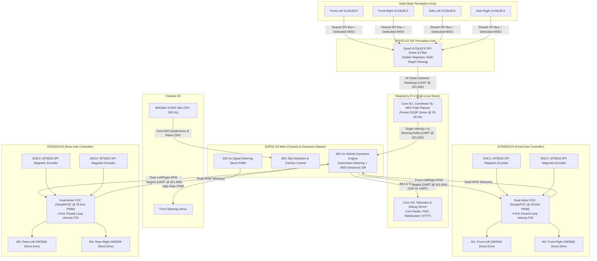

# Folkrace Autonomous High-Speed Racing Platform

An autonomous, 1:20-scale high-speed racing vehicle powered by a distributed multi-processor architecture: a **Raspberry Pi 4** companion computer running Curvilinear SL-MPC path planning, an **ESP32-S3 Main** chassis controller handling high-rate vehicle dynamics, a dedicated **ESP32-S3 ToF Hub** filtering quad multizone Time-of-Flight sensors, and **two STM32G474** microcontrollers driving 4 independent direct-drive brushless motors via hardware Field Oriented Control (FOC).

> [!IMPORTANT]
> **No LiDAR is used in this vehicle.** Perception is 100% solid-state, utilizing a quad VL53L8CX multizone Time-of-Flight array on a shared SPI bus that streams 16 distance zones directly to the Raspberry Pi 4.

---

## 1. System Hardware Architecture



---

## 2. Distributed Subsystems Summary

| Subsystem | Hardware Platform | Primary Responsibilities | Key Communication |
| :--- | :--- | :--- | :--- |
| **Brain** | [Raspberry Pi 4](file:///c:/Users/nurmi/Documents/Folkrace/pi4/README.md) | High-level path planning via Curvilinear SL-MPC on Core 0/1; live telemetry and debugging server on Core 2/3. No LiDAR. | UART from ESP32 ToF (16 zones), UART with ESP32 Main |
| **Chassis Dynamics** | [ESP32 Main](file:///c:/Users/nurmi/Documents/Folkrace/ESP32/README.md) | 400 Hz control loop: BNO08x 9-DOF IMU reading, steering servo control, 4WD electronic differential, slip/spinout watchdog. | High-speed UART to Pi 4; dual UART links to 2x STM32 |
| **Perception Hub** | [ESP32 ToF Hub](file:///c:/Users/nurmi/Documents/Folkrace/ESP32/README.md) | Manages 4x VL53L8CX multizone ToFs on one shared SPI bus with dedicated MISO lines; filters data into 16 distance zones. | UART output to Pi 4 (921,600 baud) |
| **Front Axle Motors** | [STM32 Front](file:///c:/Users/nurmi/Documents/Folkrace/STM32/README.md) | Controls 2x direct-drive GM3506 BLDC motors (FL, FR) with 2x MT6816 SPI magnetic encoders via hardware SimpleFOC at 20 kHz. | UART link with ESP32 Main; SPI1/SPI2 for encoders |
| **Rear Axle Motors** | [STM32 Rear](file:///c:/Users/nurmi/Documents/Folkrace/STM32/README.md) | Controls 2x direct-drive GM3506 BLDC motors (RL, RR) with 2x MT6816 SPI magnetic encoders via hardware SimpleFOC at 20 kHz. | UART link with ESP32 Main; SPI1/SPI2 for encoders |

---

## 3. Directory Structure

* **[pi4/](file:///c:/Users/nurmi/Documents/Folkrace/pi4/README.md)**: Raspberry Pi 4 companion stack, SL-MPC planner configuration, debug server notes, and pin mapping.
* **[ESP32/](file:///c:/Users/nurmi/Documents/Folkrace/ESP32/README.md)**:
  * **`ESP32_Main/`**: Real-time vehicle dynamics, electronic differential, BNO08x IMU driver, steering servo actuation, and STM32 UART link.
  * **`ESP32_ToF/`**: Quad VL53L8CX multi-zone Time-of-Flight driver suite, dedicated MISO bus architecture, and 16-zone distance matrix stream.
* **[STM32/](file:///c:/Users/nurmi/Documents/Folkrace/STM32/README.md)**: Dual-motor Field Oriented Control (SimpleFOC), MT6816 SPI magnetic encoder drivers, 128-point LUT calibration, and hardware timer configurations.
* **[launchers/](file:///c:/Users/nurmi/Documents/Folkrace/launchers/README.md)**: Consolidated one-click launcher scripts for simulation, genetic algorithm optimization, and hardware test benches.
* **[webots/](file:///c:/Users/nurmi/Documents/Folkrace/webots/README.md)**: Webots physics simulation, Curvilinear SL-MPC C++ solvers (`curvilinear_sl_mpc.dll`), genetic algorithm tuning benches, and virtual race tracks.
* **[docs/](file:///c:/Users/nurmi/Documents/Folkrace/docs/)**: Engineering specifications, wiring diagrams, and calibration procedures.

---

## 4. Hardware Pinout Reference (STM32G474 LQFP48 Dual-Motor FOC)

Each STM32 board controls two direct-drive brushless motors and two MT6816 magnetic angle encoders using dedicated hardware timers and SPI peripherals:

| Pin | Function / Role | Peripheral | Notes |
| :--- | :--- | :--- | :--- |
| **PA1** | Motor Phase B (M1) | TIM2_CH2 | Center-aligned 25 kHz PWM |
| **PA2** | Motor Phase C (M1) | TIM2_CH3 | Center-aligned 25 kHz PWM |
| **PA3** | Motor 1 Driver Enable | GPIO Out | Active-High driver enable |
| **PA4** | Motor Phase B (M2) | TIM3_CH2 | Center-aligned 25 kHz PWM |
| **PA5** | Motor Phase A (M1) | TIM2_CH1 | Center-aligned 25 kHz PWM |
| **PA6** | Motor Phase A (M2) | TIM3_CH1 | Center-aligned 25 kHz PWM |
| **PA7** | Motor 2 Driver Enable | GPIO Out | Active-High driver enable |
| **PA9** | Telemetry TX | USART1_TX | Communication link |
| **PA10** | Telemetry RX | USART1_RX | Communication link |
| **PA11** | USB D- | Native USB | DFU Bootloader / CDC Serial |
| **PA12** | USB D+ | Native USB | DFU Bootloader / CDC Serial |
| **PA13** | SWDIO | SWD SYS | Hardware debug data |
| **PA14** | SWCLK | SWD SYS | Hardware debug clock |
| **PA15** | Motor 1 Encoder CS | GPIO Out | SPI1 Chip Select for MT6816 #1 |
| **PB0** | Motor Phase C (M2) | TIM3_CH3 | Center-aligned 25 kHz PWM |
| **PB3** | Encoder 1 SCK | SPI1_SCK | MT6816 #1 SPI Clock |
| **PB4** | Encoder 1 MISO | SPI1_MISO | MT6816 #1 SPI Data In |
| **PB5** | Encoder 1 MOSI | SPI1_MOSI | MT6816 #1 SPI Data Out |
| **PB11** | Motor 2 Encoder CS | GPIO Out | SPI2 Chip Select for MT6816 #2 |
| **PB13** | Encoder 2 SCK | SPI2_SCK | MT6816 #2 SPI Clock (AF5) |
| **PB14** | Encoder 2 MISO | SPI2_MISO | MT6816 #2 SPI Data In (AF5) |
| **PB15** | Encoder 2 MOSI | SPI2_MOSI | MT6816 #2 SPI Data Out (AF5) |
| **PC13** | Onboard Status LED | GPIO Out | Active-Low user status LED |

---

## 5. Firmware Quick Start (PlatformIO)

The root [`platformio.ini`](file:///c:/Users/nurmi/Documents/Folkrace/platformio.ini) manages all microcontroller firmware targets:

```bash
# Build & flash STM32 Dual-FOC controller over USB DFU
pio run -e stm32_dual_foc -t upload

# Build & flash ESP32 Main (Chassis & Dynamics Master)
pio run -e esp32_main -t upload

# Build & flash ESP32 ToF Hub (Quad VL53L8CX Driver)
pio run -e esp32_tof -t upload
```

---

## 6. Verification & Test Launchers

All diagnostic GUIs and simulation suites are centralized in [`launchers/`](file:///c:/Users/nurmi/Documents/Folkrace/launchers/README.md):

```bash
# Launch physical quad VL53L8CX ToF multi-target visualizer
python launchers/6_esp32_tof_gui.py

# Launch physical high-rate steering servo calibration bench
python launchers/8_esp32_servo_gui.py

# Launch physical STM32 motor closed-loop FOC & encoder GUI
python launchers/9_stm32_encoder_motor_gui.py

# Launch Webots 3D simulation with Curvilinear SL-MPC & dynamic obstacles
python launchers/1_champion_preview.py
```
