# DA WINNA — Master Hardware Wiring & Interconnect Architecture

A unified, multi-instance color-coded connection scheme and physical pinout blueprint mapping all hardware, electrical, and protocol interconnects across **Raspberry Pi 5**, **ESP32-S3 Master / Sensor Hub**, **STM32G474 Quad-BLDC Controller**, and the sensor/actuator arrays.

---

## 🎨 Multi-Instance & Quadrant Color Coding System

Every repeated sensor channel, motor phase, encoder, and communication line is assigned a dedicated color signature for instant visual identification across all schematics and board tables:

### 1. 🏎️ 4-Quadrant Motor & Encoder System (FL / FR / RL / RR)
| Quadrant | Motor Phase Lines | Encoder Bus & CS | Color Theme |
| :--- | :--- | :--- | :--- |
| **M1 / ENC 1 (Front Left)** | <code style="background:#e8f5e9; color:#1b5e20; font-weight:bold; padding:2px 7px; border-radius:4px; border:1px solid #81c784;">M1 (FL)</code> | `PA8, PA9, PA10 (TIM1)` + `PB5 (EN)` | `PA15 (ENC1_CS)` | 🟢 **Emerald Green** |
| **M2 / ENC 2 (Front Right)** | <code style="background:#e0f7fa; color:#006064; font-weight:bold; padding:2px 7px; border-radius:4px; border:1px solid #4dd0e1;">M2 (FR)</code> | `PA0, PA1, PB10 (TIM2)` + `PB9 (EN)` | `PB1 (ENC2_CS)` | 🔵 **Cyan Blue** |
| **M3 / ENC 3 (Rear Left)** | <code style="background:#fff3e0; color:#e65100; font-weight:bold; padding:2px 7px; border-radius:4px; border:1px solid #ffb74d;">M3 (RL)</code> | `PA6, PA4, PB0 (TIM3)` + `PB11 (EN)` | `PB2 (ENC3_CS)` | 🟠 **Amber Orange** |
| **M4 / ENC 4 (Rear Right)** | <code style="background:#f3e5f5; color:#4a148c; font-weight:bold; padding:2px 7px; border-radius:4px; border:1px solid #ba68c8;">M4 (RR)</code> | `PB6/PA11, PB7/PA12, PB8 (TIM4)` + `PB12 (EN)` | `PB3 (ENC4_CS)` | 🟣 **Royal Purple** |

### 2. 🎯 5x Time-of-Flight Sensor Array (ToF 1 to 5)
| Sensor Channel | Geometry & Resolution | Dedicated CS Pin | Dedicated INT Pin | Color Theme |
| :--- | :--- | :--- | :--- | :--- |
| <code style="background:#ffebee; color:#b71c1c; font-weight:bold; padding:2px 7px; border-radius:4px; border:1px solid #ef9a9a;">ToF 1 (Center)</code> | **Front Center (4x4 Matrix @ 60Hz)** | `GPIO 10 (CS)` | `GPIO 5 (INT)` | 🔴 **Crimson Red** |
| <code style="background:#e0f2f1; color:#004d40; font-weight:bold; padding:2px 7px; border-radius:4px; border:1px solid #80cbc4;">ToF 2 (Front L)</code> | **Front Left 45° (4x4 Matrix @ 60Hz)** | `GPIO 9 (CS)` | `GPIO 4 (INT)` | 🟢 **Teal** |
| <code style="background:#e8eaf6; color:#1a237e; font-weight:bold; padding:2px 7px; border-radius:4px; border:1px solid #9fa8da;">ToF 3 (Front R)</code> | **Front Right 45° (4x4 Matrix @ 60Hz)** | `GPIO 8 (CS)` | `GPIO 14 (INT)` | 🔵 **Indigo Blue** |
| <code style="background:#fffde7; color:#f57f17; font-weight:bold; padding:2px 7px; border-radius:4px; border:1px solid #fff59d;">ToF 4 (Side L)</code> | **Side Left 90° (8x8 Matrix @ 15Hz Wide)**| `GPIO 7 (CS)` | `GPIO 15 (INT)` | 🟡 **Warm Gold** |
| <code style="background:#fce4ec; color:#880e4f; font-weight:bold; padding:2px 7px; border-radius:4px; border:1px solid #f48fb1;">ToF 5 (Side R)</code> | **Side Right 90° (8x8 Matrix @ 15Hz Wide)**| `GPIO 6 (CS)` | `GPIO 16 (INT)` | 🌸 **Rose Pink** |

### 3. ⚡ Core Bus Protocols & Power
| Bus Standard | Typical Range | Styling Badge | Color Reference |
| :--- | :--- | :--- | :--- |
| **UART Highway** | 230.4k – 2.0M Baud | <code style="background:#f3e5f5; color:#4a148c; font-weight:bold; padding:2px 6px; border-radius:4px; border:1px solid #ce93d8;">UART Link</code> | 🟣 Purple |
| **Shared SPI Bus** | 10 – 20 MHz Clock | <code style="background:#e3f2fd; color:#0d47a1; font-weight:bold; padding:2px 6px; border-radius:4px; border:1px solid #90caf9;">SPI Bus</code> | 🔵 Deep Blue |
| **PWM Actuation** | 50 Hz – 40 kHz | <code style="background:#fff3e0; color:#e65100; font-weight:bold; padding:2px 6px; border-radius:4px; border:1px solid #ffcc80;">PWM Phase</code> | 🟠 Orange |
| **Power Rails** | 3.3V, 5V, VBAT | <code style="background:#ffebee; color:#b71c1c; font-weight:bold; padding:2px 6px; border-radius:4px; border:1px solid #ef9a9a;">Power / GND</code> | 🔴 Red / ⚫ Black |

---

## 1. System Topology Architecture

```mermaid
flowchart TB
    subgraph PI5["🍓 Raspberry Pi 5 (High-Level SLAM & AI Navigator)"]
        direction TB
        P_UART2["UART2 (/dev/ttyAMA2)<br/>Pin 12 (TX) & Pin 35 (RX)"]
        P_UART4["UART4 (/dev/ttyAMA4)<br/>Pin 32 (TX) & Pin 33 (RX)"]
        P_PWR["5V Input (Pins 2, 4) & GND (Pins 6, 14, 20, 30, 34, 39)"]
    end

    subgraph LIDAR["📡 MS200 LiDAR (2D 360° Point Cloud)"]
        L_DATA["Serial TX/RX @ 230,400 Baud"]
        L_PWR["5V Power Rail"]
    end

    subgraph ESP["⚡ ESP32-S3 (Co-Processor & Sensor Hub)"]
        direction TB
        E_PI_UART["UART2 to Pi 5 (921.6k - 2M Baud)<br/>GPIO 47 (TX) & GPIO 21 (RX)"]
        E_STM_UART["UART1 to STM32 (921.6k Baud)<br/>GPIO 17 (TX) & GPIO 18 (RX)"]
        
        E_SPI2["SPI2 Master (FSPI 10-20MHz)<br/>SCK:12, MOSI:11, MISO:13"]
        E_TOF_CS["ToF CS: [1: 10, 2: 9, 3: 8, 4: 7, 5: 6]<br/>ToF INT: [1: 5, 2: 4, 3: 14, 4: 15, 5: 16]"]
        
        E_SPI3["SPI3 Master (HSPI 3MHz)<br/>SCK:39, MOSI:40, MISO:41, CS:42<br/>INT:1, RST:2, WAK:23"]
        
        E_SERVO["LEDC Steering PWM<br/>Front Servo: GPIO 22<br/>Rear Servo: GPIO 38"]
    end

    subgraph TOF_ARRAY["🎯 5x VL53L8CX Time-of-Flight Sensors"]
        T1["ToF 1 (Front Center 4x4)"]
        T2["ToF 2 (Front Left 45° 4x4)"]
        T3["ToF 3 (Front Right 45° 4x4)"]
        T4["ToF 4 (Side Left 90° 8x8)"]
        T5["ToF 5 (Side Right 90° 8x8)"]
    end

    subgraph IMU_UNIT["🧭 BNO08X 9-DOF IMU"]
        IMU_CHIP["200Hz Zero-Drift AR/VR GRV Telemetry"]
    end

    subgraph SERVOS["🛞 Steering Servos"]
        SRV1["Front Kingpin Steering Servo"]
        SRV2["Rear / Auxiliary Steering Servo"]
    end

    subgraph STM["🏎️ STM32G474 (Quad-BLDC Motor Controller)"]
        direction TB
        S_ESP_UART["USART Link to ESP32<br/>Strict: USART2 (PA2 TX, PA3 RX)<br/>Relaxed: USART1 (PB6 TX, PB7 RX)"]
        
        S_M1["M1 (FL): TIM1_CH1..3 (PA8, PA9, PA10) + EN (PB5 / Relaxed: PB3)"]
        S_M2["M2 (FR): TIM2_CH1..3 (PA0, PA1, PB10 / Relaxed: PA2) + EN (PB9 / Relaxed: PB5)"]
        S_M3["M3 (RL): TIM3_CH1..3 (PA6, PA4, PB0) + EN (PB11 / Relaxed: PB9)"]
        S_M4["M4 (RR): TIM4_CH1..3 (PB6, PB7, PB8 / Relaxed: PA11, PA12, PB8) + EN (PB12 / Relaxed: PB10)"]
        
        S_SPI1["SPI1 Master (Shared Encoder Bus)<br/>SCK: PA5, MOSI: PA7, MISO: PB4<br/>Strict CS: [ENC1: PA15, ENC2: PB1, ENC3: PB2, ENC4: PB3]<br/>Relaxed CS: [ENC1: PA3, ENC2: PA15, ENC3: PB1, ENC4: PB2]"]
    end

    subgraph MOTORS["⚙️ 4x BLDC Hub Motors"]
        M1["M1 (Front Left)"]
        M2["M2 (Front Right)"]
        M3["M3 (Rear Left)"]
        M4["M4 (Rear Right)"]
    end

    subgraph ENCODERS["🔄 4x MT6816 / MT6701 Magnetic Encoders"]
        E1["ENC 1 (Front Left)"]
        E2["ENC 2 (Front Right)"]
        E3["ENC 3 (Rear Left)"]
        E4["ENC 4 (Rear Right)"]
    end

    %% Wiring Interconnects
    P_UART4 <==> |"UART 230400"| L_DATA
    P_PWR -.-> L_PWR
    P_UART2 <==> |"Telemetry Highway (200Hz IMU + ToF)"| E_PI_UART
    E_STM_UART <==> |"400Hz Packed Motor RPM Commands & Odometry"| S_ESP_UART

    E_SPI2 ==> T1 & T2 & T3 & T4 & T5
    E_TOF_CS -.-> T1 & T2 & T3 & T4 & T5
    E_SPI3 <==> IMU_CHIP
    E_SERVO ==> SRV1 & SRV2

    S_M1 ==> M1
    S_M2 ==> M2
    S_M3 ==> M3
    S_M4 ==> M4

    S_SPI1 <==> E1 & E2 & E3 & E4
```



---

## 2. Board-to-Board Digital Highways

### A. Raspberry Pi 5 ⟷ ESP32-S3 Bridge
| Interface | Pi 5 Pin | Pi 5 Signal | ESP32 Pin | ESP32 Signal | Protocol & Speed | Recommended Wire |
| :--- | :---: | :--- | :---: | :--- | :--- | :--- |
| **Host Command TX** | **Pin 12** | `GPIO 18 (TX)` | **GPIO 21** | `PI_UART_RX` | <code style="background:#f3e5f5; color:#4a148c; font-weight:bold;">UART2</code> @ 921.6k / 2.0M Baud | 🟡 **Yellow** |
| **Telemetry Stream RX** | **Pin 35** | `GPIO 19 (RX)` | **GPIO 47** | `PI_UART_TX` | <code style="background:#f3e5f5; color:#4a148c; font-weight:bold;">UART2</code> @ 921.6k / 2.0M Baud | 🟢 **Green** |
| **Ground Reference** | **Pin 14/34** | `GND` | **GND** | `Common GND` | Star Ground Reference | ⚫ **Black** |

---

### B. ESP32-S3 ⟷ STM32G474 Control Highway
| Interface | ESP32 Pin | ESP32 Signal | STM32 Pin | STM32 Board Pin | Protocol & Speed | Recommended Wire |
| :--- | :---: | :--- | :---: | :---: | :--- | :--- |
| **Motor Target RPM TX** | **GPIO 17** | `STM32_UART_TX` | **PB7** *(PA3)* | `B7` *(A3)* | <code style="background:#f3e5f5; color:#4a148c; font-weight:bold;">USART1_RX</code> @ 921,600 Baud | 🔵 **Blue** |
| **Motor Odometry RX** | **GPIO 18** | `STM32_UART_RX` | **PB6** *(PA2)* | `B6` *(A2)* | <code style="background:#f3e5f5; color:#4a148c; font-weight:bold;">USART1_TX</code> @ 921,600 Baud | 🟣 **Purple** |
| **Ground Reference** | **GND** | `Common GND` | **GND** | `GND` | Star Ground Reference | ⚫ **Black** |

---

### C. Raspberry Pi 5 ⟷ MS200 LiDAR Highway
| Interface | Pi 5 Pin | Pi 5 Function | LiDAR Wire / Pin | Linux Port | Protocol & Speed |
| :--- | :---: | :--- | :--- | :--- | :--- |
| **LiDAR Command / PWM** | **Pin 32** | `GPIO 12 (UART4_TX)` | `LiDAR RX` | `/dev/ttyAMA4` | <code style="background:#f3e5f5; color:#4a148c; font-weight:bold;">UART4</code> Control |
| **Point Cloud Stream** | **Pin 33** | `GPIO 13 (UART4_RX)` | `LiDAR TX` | `/dev/ttyAMA4` | <code style="background:#f3e5f5; color:#4a148c; font-weight:bold;">UART4</code> @ 230,400 Baud |
| **LiDAR 5V Power** | **Pin 2 / 4** | `5V DC Power` | `LiDAR 5V` | System 5V Rail | ~300 mA Operating Current |
| **LiDAR Ground** | **Pin 6 / 9** | `0V Ground` | `LiDAR GND` | Common Ground | Return Path |

---

## 3. Physical Board Header Maps (Structured Exactly Like the Hardware)

---

### 3A. 🍓 Raspberry Pi 5 Physical 40-Pin Header Layout (2x20 Pins)

The table below maps the physical 40-pin GPIO header exactly as laid out on the Raspberry Pi 5 board:

| Left Column (Odd Pins) | Physical Pin | Pin Row | Physical Pin | Right Column (Even Pins) |
| :--- | :---: | :---: | :---: | :--- |
| <code style="background:#ffebee; color:#b71c1c; font-weight:bold; padding:2px 6px; border-radius:3px;">3V3 Power (Pin 1)</code> | **1** | **Row 1** | **2** | <code style="background:#ffebee; color:#b71c1c; font-weight:bold; padding:2px 6px; border-radius:3px;">5V Power In / Out (Pin 2)</code> |
| <code style="background:#fafafa; color:#9e9e9e; padding:2px 6px; border-radius:3px;">GPIO 2 (I2C1_SDA)</code> | **3** | **Row 2** | **4** | <code style="background:#ffebee; color:#b71c1c; font-weight:bold; padding:2px 6px; border-radius:3px;">5V Power In / Out (Pin 4)</code> |
| <code style="background:#fafafa; color:#9e9e9e; padding:2px 6px; border-radius:3px;">GPIO 3 (I2C1_SCL)</code> | **5** | **Row 3** | **6** | <code style="background:#eceff1; color:#263238; font-weight:bold; padding:2px 6px; border-radius:3px;">GND (Ground)</code> |
| <code style="background:#fafafa; color:#9e9e9e; padding:2px 6px; border-radius:3px;">GPIO 4 (GPCLK0)</code> | **7** | **Row 4** | **8** | <code style="background:#fafafa; color:#9e9e9e; padding:2px 6px; border-radius:3px;">GPIO 14 (UART0_TX Console)</code> |
| <code style="background:#eceff1; color:#263238; font-weight:bold; padding:2px 6px; border-radius:3px;">GND (Ground)</code> | **9** | **Row 5** | **10** | <code style="background:#fafafa; color:#9e9e9e; padding:2px 6px; border-radius:3px;">GPIO 15 (UART0_RX Console)</code> |
| <code style="background:#fafafa; color:#9e9e9e; padding:2px 6px; border-radius:3px;">GPIO 17 (Free GPIO)</code> | **11** | **Row 6** | **12** | <code style="background:#f3e5f5; color:#4a148c; font-weight:bold; padding:2px 6px; border-radius:3px; border:1px solid #ce93d8;">GPIO 18 (UART2_TX -> ESP32 RX)</code> |
| <code style="background:#fafafa; color:#9e9e9e; padding:2px 6px; border-radius:3px;">GPIO 27 (Free GPIO)</code> | **13** | **Row 7** | **14** | <code style="background:#eceff1; color:#263238; font-weight:bold; padding:2px 6px; border-radius:3px;">GND (Ground)</code> |
| <code style="background:#fafafa; color:#9e9e9e; padding:2px 6px; border-radius:3px;">GPIO 22 (Free GPIO)</code> | **15** | **Row 8** | **16** | <code style="background:#fafafa; color:#9e9e9e; padding:2px 6px; border-radius:3px;">GPIO 23 (Free GPIO)</code> |
| <code style="background:#ffebee; color:#b71c1c; font-weight:bold; padding:2px 6px; border-radius:3px;">3V3 Power (Pin 17)</code> | **17** | **Row 9** | **18** | <code style="background:#fafafa; color:#9e9e9e; padding:2px 6px; border-radius:3px;">GPIO 24 (Free GPIO)</code> |
| <code style="background:#fafafa; color:#9e9e9e; padding:2px 6px; border-radius:3px;">GPIO 10 (SPI0_MOSI)</code> | **19** | **Row 10** | **20** | <code style="background:#eceff1; color:#263238; font-weight:bold; padding:2px 6px; border-radius:3px;">GND (Ground)</code> |
| <code style="background:#fafafa; color:#9e9e9e; padding:2px 6px; border-radius:3px;">GPIO 9 (SPI0_MISO)</code> | **21** | **Row 11** | **22** | <code style="background:#fafafa; color:#9e9e9e; padding:2px 6px; border-radius:3px;">GPIO 25 (Free GPIO)</code> |
| <code style="background:#fafafa; color:#9e9e9e; padding:2px 6px; border-radius:3px;">GPIO 11 (SPI0_SCLK)</code> | **23** | **Row 12** | **24** | <code style="background:#fafafa; color:#9e9e9e; padding:2px 6px; border-radius:3px;">GPIO 8 (SPI0_CE0)</code> |
| <code style="background:#eceff1; color:#263238; font-weight:bold; padding:2px 6px; border-radius:3px;">GND (Ground)</code> | **25** | **Row 13** | **26** | <code style="background:#fafafa; color:#9e9e9e; padding:2px 6px; border-radius:3px;">GPIO 7 (SPI0_CE1)</code> |
| <code style="background:#fafafa; color:#bdbdbd; padding:2px 6px; border-radius:3px;">GPIO 0 (ID_SD EEPROM)</code> | **27** | **Row 14** | **28** | <code style="background:#fafafa; color:#bdbdbd; padding:2px 6px; border-radius:3px;">GPIO 1 (ID_SC EEPROM)</code> |
| <code style="background:#fafafa; color:#9e9e9e; padding:2px 6px; border-radius:3px;">GPIO 5 (Free GPIO)</code> | **29** | **Row 15** | **30** | <code style="background:#eceff1; color:#263238; font-weight:bold; padding:2px 6px; border-radius:3px;">GND (Ground)</code> |
| <code style="background:#fafafa; color:#9e9e9e; padding:2px 6px; border-radius:3px;">GPIO 6 (Free GPIO)</code> | **31** | **Row 16** | **32** | <code style="background:#f3e5f5; color:#4a148c; font-weight:bold; padding:2px 6px; border-radius:3px; border:1px solid #ce93d8;">GPIO 12 (UART4_TX -> LiDAR RX)</code> |
| <code style="background:#f3e5f5; color:#4a148c; font-weight:bold; padding:2px 6px; border-radius:3px; border:1px solid #ce93d8;">GPIO 13 (UART4_RX <- LiDAR TX)</code> | **33** | **Row 17** | **34** | <code style="background:#eceff1; color:#263238; font-weight:bold; padding:2px 6px; border-radius:3px;">GND (Ground)</code> |
| <code style="background:#f3e5f5; color:#4a148c; font-weight:bold; padding:2px 6px; border-radius:3px; border:1px solid #ce93d8;">GPIO 19 (UART2_RX <- ESP32 TX)</code> | **35** | **Row 18** | **36** | <code style="background:#fafafa; color:#9e9e9e; padding:2px 6px; border-radius:3px;">GPIO 16 (Free GPIO)</code> |
| <code style="background:#fafafa; color:#9e9e9e; padding:2px 6px; border-radius:3px;">GPIO 26 (Free GPIO)</code> | **37** | **Row 19** | **38** | <code style="background:#fafafa; color:#9e9e9e; padding:2px 6px; border-radius:3px;">GPIO 20 (Free GPIO)</code> |
| <code style="background:#eceff1; color:#263238; font-weight:bold; padding:2px 6px; border-radius:3px;">GND (Ground)</code> | **39** | **Row 20** | **40** | <code style="background:#fafafa; color:#9e9e9e; padding:2px 6px; border-radius:3px;">GPIO 21 (Free GPIO)</code> |

---

### 3B. ⚡ ESP32-S3 Dev Board Physical Dual Header Layout (2x22 Pins)

The table below maps the physical left header (J1) and right header (J3) of the ESP32-S3 board:

| Left Header Pin (J1) | Pin Role / Connection | Row | Right Header Pin (J3) | Pin Role / Connection |
| :--- | :--- | :---: | :--- | :--- |
| <code style="background:#ffebee; color:#b71c1c; font-weight:bold; padding:2px 6px; border-radius:3px;">3V3</code> | 3.3V Power Rail | **Row 1** | <code style="background:#eceff1; color:#263238; font-weight:bold; padding:2px 6px; border-radius:3px;">GND</code> | System Ground |
| <code style="background:#fffde7; color:#f57f17; font-weight:bold; padding:2px 6px; border-radius:3px;">EN / RST</code> | Reset Button (Active LOW) | **Row 2** | <code style="background:#fafafa; color:#9e9e9e; padding:2px 6px; border-radius:3px;">TX (GPIO 43)</code> | UART0 Console TX (CH343P) |
| <code style="background:#e0f2f1; color:#004d40; font-weight:bold; padding:2px 6px; border-radius:3px;">GPIO 4</code> | <code style="background:#e0f2f1; color:#004d40; font-weight:bold; padding:1px 5px; border-radius:3px;">ToF 2 (Front L) INT</code> | **Row 3** | <code style="background:#fafafa; color:#9e9e9e; padding:2px 6px; border-radius:3px;">RX (GPIO 44)</code> | UART0 Console RX (CH343P) |
| <code style="background:#ffebee; color:#b71c1c; font-weight:bold; padding:2px 6px; border-radius:3px;">GPIO 5</code> | <code style="background:#ffebee; color:#b71c1c; font-weight:bold; padding:1px 5px; border-radius:3px;">ToF 1 (Center) INT</code> | **Row 4** | <code style="background:#e3f2fd; color:#0d47a1; font-weight:bold; padding:2px 6px; border-radius:3px;">GPIO 1</code> | BNO08X IMU Data Ready (INT) |
| <code style="background:#fce4ec; color:#880e4f; font-weight:bold; padding:2px 6px; border-radius:3px;">GPIO 6</code> | <code style="background:#fce4ec; color:#880e4f; font-weight:bold; padding:1px 5px; border-radius:3px;">ToF 5 (Side R) CS</code> | **Row 5** | <code style="background:#e3f2fd; color:#0d47a1; font-weight:bold; padding:2px 6px; border-radius:3px;">GPIO 2</code> | BNO08X IMU Reset (RST) |
| <code style="background:#fffde7; color:#f57f17; font-weight:bold; padding:2px 6px; border-radius:3px;">GPIO 7</code> | <code style="background:#fffde7; color:#f57f17; font-weight:bold; padding:1px 5px; border-radius:3px;">ToF 4 (Side L) CS</code> | **Row 6** | <code style="background:#e3f2fd; color:#0d47a1; font-weight:bold; padding:2px 6px; border-radius:3px;">GPIO 42</code> | BNO08X IMU SPI3 Chip Select (CS) |
| <code style="background:#fffde7; color:#f57f17; font-weight:bold; padding:2px 6px; border-radius:3px;">GPIO 15</code> | <code style="background:#fffde7; color:#f57f17; font-weight:bold; padding:1px 5px; border-radius:3px;">ToF 4 (Side L) INT</code> | **Row 7** | <code style="background:#e3f2fd; color:#0d47a1; font-weight:bold; padding:2px 6px; border-radius:3px;">GPIO 41</code> | BNO08X IMU SPI3 MISO (Data In) |
| <code style="background:#fce4ec; color:#880e4f; font-weight:bold; padding:2px 6px; border-radius:3px;">GPIO 16</code> | <code style="background:#fce4ec; color:#880e4f; font-weight:bold; padding:1px 5px; border-radius:3px;">ToF 5 (Side R) INT</code> | **Row 8** | <code style="background:#e3f2fd; color:#0d47a1; font-weight:bold; padding:2px 6px; border-radius:3px;">GPIO 40</code> | BNO08X IMU SPI3 MOSI (Cmd Out)|
| <code style="background:#f3e5f5; color:#4a148c; font-weight:bold; padding:2px 6px; border-radius:3px;">GPIO 17</code> | <code style="background:#f3e5f5; color:#4a148c; font-weight:bold; padding:1px 5px; border-radius:3px;">UART1_TX -> STM32 RX</code> | **Row 9** | <code style="background:#e3f2fd; color:#0d47a1; font-weight:bold; padding:2px 6px; border-radius:3px;">GPIO 39</code> | BNO08X IMU SPI3 SCK (3 MHz) |
| <code style="background:#f3e5f5; color:#4a148c; font-weight:bold; padding:2px 6px; border-radius:3px;">GPIO 18</code> | <code style="background:#f3e5f5; color:#4a148c; font-weight:bold; padding:1px 5px; border-radius:3px;">UART1_RX <- STM32 TX</code> | **Row 10** | <code style="background:#fff3e0; color:#e65100; font-weight:bold; padding:2px 6px; border-radius:3px;">GPIO 38</code> | Steering Servo 2 PWM (Aux) |
| <code style="background:#e8eaf6; color:#1a237e; font-weight:bold; padding:2px 6px; border-radius:3px;">GPIO 8</code> | <code style="background:#e8eaf6; color:#1a237e; font-weight:bold; padding:1px 5px; border-radius:3px;">ToF 3 (Front R) CS</code> | **Row 11** | <code style="background:#ffebee; color:#b71c1c; padding:2px 6px; border-radius:3px;">GPIO 37</code> | *RESERVED (Octal PSRAM DQS)* |
| <code style="background:#fafafa; color:#9e9e9e; padding:2px 6px; border-radius:3px;">GPIO 3</code> | Strapping Pin / JTAG Select | **Row 12** | <code style="background:#ffebee; color:#b71c1c; padding:2px 6px; border-radius:3px;">GPIO 36</code> | *RESERVED (Octal PSRAM DQ7)* |
| <code style="background:#fafafa; color:#9e9e9e; padding:2px 6px; border-radius:3px;">GPIO 46</code> | Strapping Pin / ROM Print | **Row 13** | <code style="background:#ffebee; color:#b71c1c; padding:2px 6px; border-radius:3px;">GPIO 35</code> | *RESERVED (Octal PSRAM DQ6)* |
| <code style="background:#e0f2f1; color:#004d40; font-weight:bold; padding:2px 6px; border-radius:3px;">GPIO 9</code> | <code style="background:#e0f2f1; color:#004d40; font-weight:bold; padding:1px 5px; border-radius:3px;">ToF 2 (Front L) CS</code> | **Row 14** | <code style="background:#ffebee; color:#b71c1c; padding:2px 6px; border-radius:3px;">GPIO 34</code> | *RESERVED (Octal PSRAM DQ5)* |
| <code style="background:#ffebee; color:#b71c1c; font-weight:bold; padding:2px 6px; border-radius:3px;">GPIO 10</code> | <code style="background:#ffebee; color:#b71c1c; font-weight:bold; padding:1px 5px; border-radius:3px;">ToF 1 (Center) CS</code> | **Row 15** | <code style="background:#ffebee; color:#b71c1c; padding:2px 6px; border-radius:3px;">GPIO 33</code> | *RESERVED (Octal PSRAM DQ4)* |
| <code style="background:#e3f2fd; color:#0d47a1; font-weight:bold; padding:2px 6px; border-radius:3px;">GPIO 11</code> | <code style="background:#e3f2fd; color:#0d47a1; font-weight:bold; padding:1px 5px; border-radius:3px;">ToF SPI2 MOSI (Shared)</code>| **Row 16** | <code style="background:#f3e5f5; color:#4a148c; font-weight:bold; padding:2px 6px; border-radius:3px;">GPIO 47</code> | <code style="background:#f3e5f5; color:#4a148c; font-weight:bold; padding:1px 5px; border-radius:3px;">UART2_TX -> Pi 5 Pin 35 RX</code>|
| <code style="background:#e3f2fd; color:#0d47a1; font-weight:bold; padding:2px 6px; border-radius:3px;">GPIO 12</code> | <code style="background:#e3f2fd; color:#0d47a1; font-weight:bold; padding:1px 5px; border-radius:3px;">ToF SPI2 SCK (Shared)</code> | **Row 17** | <code style="background:#e0f2f1; color:#004d40; font-weight:bold; padding:2px 6px; border-radius:3px;">GPIO 48</code> | Onboard WS2812 RGB LED |
| <code style="background:#e3f2fd; color:#0d47a1; font-weight:bold; padding:2px 6px; border-radius:3px;">GPIO 13</code> | <code style="background:#e3f2fd; color:#0d47a1; font-weight:bold; padding:1px 5px; border-radius:3px;">ToF SPI2 MISO (Shared)</code>| **Row 18** | <code style="background:#ffebee; color:#b71c1c; padding:2px 6px; border-radius:3px;">GPIO 45</code> | *VDD_SPI Strap (Do NOT pull HIGH)*|
| <code style="background:#e8eaf6; color:#1a237e; font-weight:bold; padding:2px 6px; border-radius:3px;">GPIO 14</code> | <code style="background:#e8eaf6; color:#1a237e; font-weight:bold; padding:1px 5px; border-radius:3px;">ToF 3 (Front R) INT</code> | **Row 19** | <code style="background:#fffde7; color:#f57f17; font-weight:bold; padding:2px 6px; border-radius:3px;">GPIO 0</code> | BOOT Button (Pull LOW for Flashing)|
| <code style="background:#ffebee; color:#b71c1c; font-weight:bold; padding:2px 6px; border-radius:3px;">5V / VBUS</code> | 5V Power Supply Input | **Row 20** | <code style="background:#f3e5f5; color:#4a148c; font-weight:bold; padding:2px 6px; border-radius:3px;">GPIO 21</code> | <code style="background:#f3e5f5; color:#4a148c; font-weight:bold; padding:1px 5px; border-radius:3px;">UART2_RX <- Pi 5 Pin 12 TX</code>|
| <code style="background:#eceff1; color:#263238; font-weight:bold; padding:2px 6px; border-radius:3px;">GND</code> | System Ground | **Row 21** | <code style="background:#fff3e0; color:#e65100; font-weight:bold; padding:2px 6px; border-radius:3px;">GPIO 22</code> | Steering Servo 1 PWM (Kingpin) |
| <code style="background:#eceff1; color:#263238; font-weight:bold; padding:2px 6px; border-radius:3px;">GND</code> | System Ground | **Row 22** | <code style="background:#e3f2fd; color:#0d47a1; font-weight:bold; padding:2px 6px; border-radius:3px;">GPIO 23</code> | BNO08X IMU Wake Pin (WAK) |

---

### 3C. 🏎️ STM32G474 Quad-BLDC Board Physical Header Layout (2x10 Dual-Row)

The table below maps the physical 2x10 dual-row header of the STM32 motor controller board:

| Left Outer Header | Left Inner Header | Row | Right Inner Header | Right Outer Header |
| :--- | :--- | :---: | :--- | :--- |
| <code style="background:#ffebee; color:#b71c1c; font-weight:bold; padding:2px 5px; border-radius:3px;">VCC (+5V)</code> | <code style="background:#ffebee; color:#b71c1c; font-weight:bold; padding:2px 5px; border-radius:3px;">VCC (+5V)</code> | **Row 1** | <code style="background:#ffebee; color:#b71c1c; font-weight:bold; padding:2px 5px; border-radius:3px;">3V3</code> | <code style="background:#ffebee; color:#b71c1c; font-weight:bold; padding:2px 5px; border-radius:3px;">3V3</code> |
| <code style="background:#eceff1; color:#263238; font-weight:bold; padding:2px 5px; border-radius:3px;">GND</code> | <code style="background:#eceff1; color:#263238; font-weight:bold; padding:2px 5px; border-radius:3px;">GND</code> | **Row 2** | <code style="background:#eceff1; color:#263238; font-weight:bold; padding:2px 5px; border-radius:3px;">GND</code> | <code style="background:#eceff1; color:#263238; font-weight:bold; padding:2px 5px; border-radius:3px;">GND</code> |
| <code style="background:#f3e5f5; color:#4a148c; padding:2px 5px; border-radius:3px;">M4_EN (PB12)</code> | <code style="background:#fff3e0; color:#e65100; padding:2px 5px; border-radius:3px;">M3_EN (PB11)</code> | **Row 3** | <code style="background:#e0f7fa; color:#006064; padding:2px 5px; border-radius:3px;">M2_PWM_C (PB10)</code> | <code style="background:#e0f7fa; color:#006064; padding:2px 5px; border-radius:3px;">M2_EN (PB9)</code> |
| <code style="background:#f3e5f5; color:#4a148c; padding:2px 5px; border-radius:3px;">M4_PWM_C (PB8)</code> | <code style="background:#f3e5f5; color:#4a148c; font-weight:bold; padding:2px 5px; border-radius:3px;">UART_RX (PB7)</code> | **Row 4** | <code style="background:#ffebee; color:#b71c1c; font-weight:bold; padding:2px 5px; border-radius:3px;">VBAT (Motor V+)</code> | <code style="background:#fff3e0; color:#e65100; font-weight:bold; padding:2px 5px; border-radius:3px;">ENC3_CS (PB2)</code> |
| <code style="background:#f3e5f5; color:#4a148c; font-weight:bold; padding:2px 5px; border-radius:3px;">UART_TX (PB6)</code> | <code style="background:#e8f5e9; color:#1b5e20; padding:2px 5px; border-radius:3px;">M1_EN (PB5)</code> | **Row 5** | <code style="background:#e0f7fa; color:#006064; font-weight:bold; padding:2px 5px; border-radius:3px;">ENC2_CS (PB1)</code> | <code style="background:#fff3e0; color:#e65100; padding:2px 5px; border-radius:3px;">M3_PWM_C (PB0)</code> |
| <code style="background:#e3f2fd; color:#0d47a1; font-weight:bold; padding:2px 5px; border-radius:3px;">ENC_MISO (PB4)</code>| <code style="background:#f3e5f5; color:#4a148c; font-weight:bold; padding:2px 5px; border-radius:3px;">ENC4_CS (PB3)</code> | **Row 6** | <code style="background:#e8f5e9; color:#1b5e20; padding:2px 5px; border-radius:3px;">M1_PWM_C (PA10)</code> | <code style="background:#e3f2fd; color:#0d47a1; padding:2px 5px; border-radius:3px;">ENC_MOSI (PA7)</code> |
| <code style="background:#f3e5f5; color:#4a148c; padding:2px 5px; border-radius:3px;">M4_PWM_B (PA12)</code>| <code style="background:#f3e5f5; color:#4a148c; padding:2px 5px; border-radius:3px;">M4_PWM_A (PA11)</code>| **Row 7** | <code style="background:#fff3e0; color:#e65100; padding:2px 5px; border-radius:3px;">M3_PWM_A (PA6)</code> | <code style="background:#e3f2fd; color:#0d47a1; font-weight:bold; padding:2px 5px; border-radius:3px;">ENC_SCK (PA5)</code> |
| <code style="background:#e8f5e9; color:#1b5e20; font-weight:bold; padding:2px 5px; border-radius:3px;">ENC1_CS (PA15)</code>| <code style="background:#fafafa; color:#9e9e9e; padding:2px 5px; border-radius:3px;">SWCLK (PA14)</code> | **Row 8** | <code style="background:#fff3e0; color:#e65100; padding:2px 5px; border-radius:3px;">M3_PWM_B (PA4)</code> | <code style="background:#e8f5e9; color:#1b5e20; padding:2px 5px; border-radius:3px;">M1_PWM_B (PA9)</code> |
| <code style="background:#fafafa; color:#9e9e9e; padding:2px 5px; border-radius:3px;">SWDIO (PA13)</code> | <code style="background:#fafafa; color:#9e9e9e; padding:2px 5px; border-radius:3px;">NC</code> | **Row 9** | <code style="background:#e8f5e9; color:#1b5e20; padding:2px 5px; border-radius:3px;">M1_PWM_A (PA8)</code> | <code style="background:#e0f7fa; color:#006064; padding:2px 5px; border-radius:3px;">M2_PWM_B (PA1)</code> |
| <code style="background:#fafafa; color:#9e9e9e; padding:2px 5px; border-radius:3px;">NRST</code> | <code style="background:#e0f2f1; color:#004d40; padding:2px 5px; border-radius:3px;">LED (PC13)</code> | **Row 10 (Bottom)**| <code style="background:#e0f7fa; color:#006064; padding:2px 5px; border-radius:3px;">M2_PWM_A (PA0)</code> | <code style="background:#ffebee; color:#b71c1c; font-weight:bold; padding:2px 5px; border-radius:3px;">VB (Backup)</code> |

---

## 4. Power Distribution Blueprint

```
[ LiPo Battery (2S-4S / 7.4V - 14.8V) ]
     │
     ├───► [ High-Power VBAT Rail ] ────────► STM32 4x Half-Bridge Inverters (M1-M4 Motors)
     │
     └───► [ 5V / 8A Step-Down Buck DCDC ]
              │
              ├───► Raspberry Pi 5 (Pins 2 & 4) [~3A - 5A Peak]
              ├───► ESP32-S3 Master 5V Rail [~300mA]
              ├───► MS200 LiDAR (5V Rail) [~350mA]
              ├───► Steering Servos (5V-6V Power Bus) [~1.5A Peak]
              │
              └───► [ 3.3V Regulators on respective boards ]
                       ├───► BNO08X 9-DOF IMU (3.3V @ ~30mA)
                       ├───► 5x VL53L8CX ToF Array (3.3V @ ~250mA total)
                       └───► 4x MT6816 Magnetic Encoders (3.3V @ ~60mA total)
```
