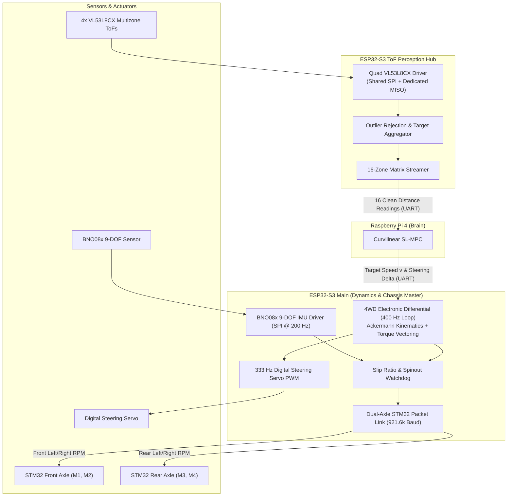

# ESP32 Dual-Controller Architecture

The Folkrace platform delegates low-level embedded responsibilities between **two dedicated ESP32-S3 microcontrollers** to separate high-frequency optical sensor processing from hard real-time chassis dynamics and motor orchestration:

1. **[ESP32 Main (`ESP32_Main/`)](file:///c:/Users/nurmi/Documents/Folkrace/ESP32/ESP32_Main/)**: Real-time vehicle dynamics engine, BNO08x 9-DOF IMU reading, steering servo actuation, 4WD electronic differential, and master UART links to both front and rear STM32 FOC motor controllers.
2. **[ESP32 ToF Hub (`ESP32_ToF/`)](file:///c:/Users/nurmi/Documents/Folkrace/ESP32/ESP32_ToF/)**: Dedicated perception co-processor interfacing with 4x VL53L8CX multizone Time-of-Flight sensors over a shared SPI bus, executing outlier filtering, and streaming 16 distance readings to the Raspberry Pi 4.

---

## 1. Subsystem Division of Responsibilities



---

## 2. ESP32 Main: Motion, Dynamics & Chassis Master

### Key Responsibilities
* **400 Hz Real-Time Dynamics Loop**:
  * Receives target longitudinal speed `v` and virtual steering angle `delta` from Raspberry Pi 4.
  * Calculates geometric front wheel Ackermann angles for steering servo.
  * **4WD Electronic Differential**:
    * Rear axle speeds: `v_RL = v - (omega_cmd * W_r * 0.5)`, `v_RR = v + (omega_cmd * W_r * 0.5)`
    * Front axle speeds: computed along independent Ackermann wheel vectors.
    * Proportional saturation scaling preserves turning radius without inducing uncommanded yaw jerks.
* **BNO08x 9-DOF IMU Interface**:
  * High-speed SPI communication with interrupt pin (`INT`).
  * Extracts zero-drift quaternions, calibrated yaw rate (`omega_z`), and lateral acceleration.
  * Streams 42-byte binary telemetry frames to Raspberry Pi 4 at 100 Hz.
* **Traction Control & Slip Detection**:
  * Compares commanded kinematic yaw rate with IMU gyro feedback.
  * Detects wheel spinout or severe understeer and clamps motor speed targets.
* **Dual STM32 Communication**:
  * High-speed UART link @ 921,600 baud streaming binary target RPM packets to the front and rear axle STM32 controllers.

### Hardware Pinout (ESP32-S3 DevKitC-1)
| Function | GPIO Pin | Connected Device / Role | Notes |
| :--- | :--- | :--- | :--- |
| **STM32 UART 1 TX** | GPIO 17 | STM32 Front PA10 RX | Motor target velocity packets (921,600 baud) |
| **STM32 UART 1 RX** | GPIO 18 | STM32 Front PA9 TX | Motor actual RPM telemetry packets |
| **STM32 UART 2 TX** | GPIO 15 | STM32 Rear PA10 RX | Motor target velocity packets (921,600 baud) |
| **STM32 UART 2 RX** | GPIO 16 | STM32 Rear PA9 TX | Motor actual RPM telemetry packets |
| **Host Link (Pi 4)** | USB Port | Raspberry Pi 4 USB Port | Direct USB Cable (Serial CDC / UART0 @ 921.6k) |
| **IMU SPI SCK** | GPIO 12 | BNO08x SCK | Dedicated IMU SPI Clock (Header J1 Pin 18) |
| **IMU SPI MOSI** | GPIO 11 | BNO08x MOSI / DI | IMU SPI Data In (Header J1 Pin 17) |
| **IMU SPI MISO** | GPIO 13 | BNO08x MISO / DO | IMU SPI Data Out (Header J1 Pin 19) |
| **IMU SPI CS** | GPIO 10 | BNO08x CSN | Active-Low Chip Select (Header J1 Pin 16) |
| **IMU INT** | GPIO 9 | BNO08x HINTN | Data-Ready Host Interrupt (Header J1 Pin 15) |
| **IMU RST** | GPIO 14 | BNO08x NRST | Hardware Reset (Header J1 Pin 20) |
| **Steering PWM** | GPIO 21 | Front Steering Servo | 333 Hz high-rate digital PWM (Header J3 Pin 18) |

---

## 3. ESP32 ToF Hub: Dedicated Perception MCU

### Key Responsibilities
* **Quad VL53L8CX Sensor Management**:
  * Operates 4 multizone Time-of-Flight sensors (Front-Left, Front-Right, Side-Left, Side-Right).
  * Uses a **single shared SPI bus** for SCK and MOSI.
  * Employs **dedicated per-sensor MISO lines** to eliminate bus contention caused by unbuffered tri-state pins on standard breakout boards.
* **Real-Time Data Filtering & Matrix Extraction**:
  * Gathers 4x4 ranging matrices @ 60 Hz per sensor.
  * Applies outlier filtering, signal-to-noise gating, and multi-target extraction (closest obstacle selection).
  * Formats and packages a consolidated stream of **16 distance readings** for dynamic costmap creation on the Raspberry Pi 4.

### Hardware Pinout (ESP32-S3 DevKitC-1)
| Function | GPIO Pin | Header Location | Connected Sensor / Role |
| :--- | :--- | :--- | :--- |
| **Shared SPI SCK** | GPIO 13 | J1 Pin 19 | Common Clock to all 4 sensors |
| **Shared SPI MOSI** | GPIO 14 | J1 Pin 20 | Common Data to all 4 sensors |
| **ToF 1 MISO** | GPIO 4 | J1 Pin 4 | ToF 1 (Front Left) Dedicated Data Out |
| **ToF 1 LPN** | GPIO 5 | J1 Pin 5 | ToF 1 Power Enable / Reset |
| **ToF 1 INT** | GPIO 6 | J1 Pin 6 | ToF 1 Data Ready Interrupt |
| **ToF 1 CS** | GPIO 7 | J1 Pin 7 | ToF 1 Chip Select (Active LOW) |
| **ToF 2 MISO** | GPIO 9 | J1 Pin 15 | ToF 2 (Front Right) Dedicated Data Out |
| **ToF 2 LPN** | GPIO 10 | J1 Pin 16 | ToF 2 Power Enable / Reset |
| **ToF 2 INT** | GPIO 11 | J1 Pin 17 | ToF 2 Data Ready Interrupt |
| **ToF 2 CS** | GPIO 12 | J1 Pin 18 | ToF 2 Chip Select (Active LOW) |
| **ToF 3 MISO** | GPIO 1 | J3 Pin 4 | ToF 3 (Side Left) Dedicated Data Out |
| **ToF 3 LPN** | GPIO 2 | J3 Pin 5 | ToF 3 Power Enable / Reset |
| **ToF 3 INT** | GPIO 42 | J3 Pin 6 | ToF 3 Data Ready Interrupt |
| **ToF 3 CS** | GPIO 41 | J3 Pin 7 | ToF 3 Chip Select (Active LOW) |
| **ToF 4 MISO** | GPIO 40 | J3 Pin 8 | ToF 4 (Side Right) Dedicated Data Out |
| **ToF 4 LPN** | GPIO 39 | J3 Pin 9 | ToF 4 Power Enable / Reset |
| **ToF 4 INT** | GPIO 38 | J3 Pin 10 | ToF 4 Data Ready Interrupt |
| **ToF 4 CS** | GPIO 47 | J3 Pin 17 | ToF 4 Chip Select (Active LOW) |
| **Host Link (Pi 4)** | USB Port | USB Cable to Pi 4 | Direct USB connection (/dev/ttyUSB1 or /dev/ttyACM1 @ 921.6k) |

---

## 4. Building & Flashing Firmware

Using PlatformIO from the root workspace directory:

```bash
# Flash ESP32 Main (Chassis & Dynamics Master)
pio run -e esp32_main -t upload

# Flash ESP32 ToF Hub (Perception Hub)
pio run -e esp32_tof -t upload

# Monitor ESP32 Main telemetry
pio device monitor -e esp32_main

# Monitor ESP32 ToF Hub ranging data
pio device monitor -e esp32_tof
```

---

## 5. Diagnostic Launchers

* **Quad VL53L8CX ToF Multi-Target Telemetry & Radar**:
  ```bash
  python launchers/6_esp32_tof_gui.py
  ```
* **BNO086 9-DOF IMU 3D Mission Dashboard**:
  ```bash
  python launchers/7_esp32_imu_gui.py
  ```
* **High-Rate Digital Steering Servo Bench**:
  ```bash
  python launchers/8_esp32_servo_gui.py
  ```
