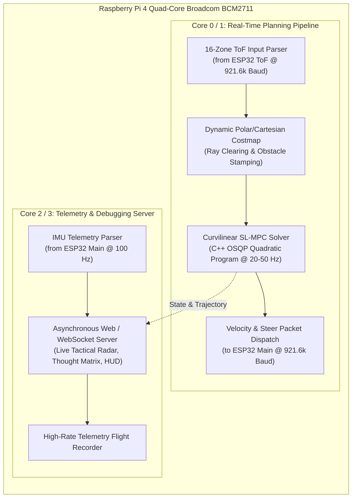

# Raspberry Pi 4 — Autonomous Racing Brain & Companion Computer

The **Raspberry Pi 4 Model B** acts as the high-level brain and companion computer of the Folkrace vehicle. It is responsible for multi-zone Time-of-Flight (ToF) perception processing, dynamic obstacle costmap generation, Curvilinear SL-MPC trajectory optimization, and asynchronous live telemetry streaming.

> [!IMPORTANT]
> **Zero LiDAR Requirement**: The physical racing stack operates exclusively on solid-state Time-of-Flight perception. No rotating LiDAR, SLAM scan-matching, or Cartographer package is used on the active vehicle.

---

## 1. Multi-Core System Architecture

To prevent visualization, logging, or network I/O from causing jitter in the real-time path planner, workload execution is split across dedicated CPU cores:



### Core Allocation:
* **Core 0 & 1 (Deterministic Control & Planning)**:
  * Ingests 16-zone distance readings from the ESP32 ToF Hub over high-speed UART.
  * Updates the dynamic vehicle costmap with spatial clustering and safe ray clearing.
  * Solves the **Curvilinear SL-MPC** (Successive Linearization Model Predictive Control) optimization problem formulated as a Quadratic Program (QP) and solved via OSQP in C++.
  * Generates optimal forward velocity setpoints and steering angle commands, transmitting them to the ESP32 Main chassis controller.
* **Core 2 & 3 (Diagnostics & Telemetry)**:
  * Hosts the local debugging server (HTTP / WebSockets / UDP) for real-time live telemetry display.
  * Displays the 2D tactical radar, vehicle heading, slip alerts, and MPC prediction horizon on mobile/laptop browsers.
  * High-speed logging to flash storage without interrupting the real-time planner.

---

## 2. Hardware Interfaces & Data Flows

### A. ESP32 ToF Hub Link (Perception Ingestion)
* **Protocol**: High-speed binary packet stream over UART @ 921,600 baud.
* **Payload**: 16 filtered distance readings (in millimeters) originating from the 4x VL53L8CX multizone sensors.
* **Update Rate**: 30 to 60 Hz.
* **Purpose**: Feeds the local costmap, detecting track barriers, corners, dynamic opponents, and opening gaps.

### B. ESP32 Main Link (Dynamics & IMU Master)
* **Protocol**: Bidirectional high-speed UART @ 921,600 baud.
* **Downlink (Pi 4 -> ESP32 Main)**:
  * Commanded vehicle speed `v` (in m/s).
  * Commanded Ackermann virtual steering angle `delta` (in radians).
  * System operational flags (run, pause, emergency brake, recovery mode).
* **Uplink (ESP32 Main -> Pi 4)**:
  * 100 Hz binary IMU packet (quaternions `w, x, y, z`, 3-axis accelerometer, 3-axis gyroscope).
  * Individual wheel shaft RPMs and electronic differential status.
  * Traction status, slip detection flags, and watchdog counters.

---

## 3. Path Planning: Curvilinear SL-MPC

The path planning engine is based on Curvilinear Successive Linearization Model Predictive Control:

* **State Space**: Formulated in the Frenet frame relative to track progress:
  * `s`: Arc length distance along the track reference line.
  * `e_y`: Lateral deviation from the track center.
  * `e_psi`: Heading angle error relative to the track tangent.
  * `v`: Longitudinal vehicle velocity.
* **Constraints**:
  * Track boundary limits derived from the 16-zone ToF distance measurements.
  * Maximum front wheel steering angle limit (plus or minus 30 degrees / 0.5236 rad).
  * Steering rate limits for smooth servo actuation.
  * Maximum wheel RPM limits and lateral acceleration friction circle bounds (`a_y <= mu * g`).
* **Obstacle Avoidance**:
  * Dynamic obstacle envelopes are projected into the Frenet frame.
  * Hard and soft clearance buffers ensure collision-free trajectories while maximizing apex speed.

---

## 4. Raspberry Pi 4 Pin Assignment

The Pi 4 communicates with the microcontrollers using its onboard hardware UART peripherals on the 40-pin GPIO header:

| Header Pin | Broadcom GPIO | Hardware Function | Connected Subsystem | Role |
| :--- | :--- | :--- | :--- | :--- |
| **Pin 8** | GPIO 14 | UART0 TX | Host PC / Debug Console | Primary Linux Serial Console |
| **Pin 10** | GPIO 15 | UART0 RX | Host PC / Debug Console | Primary Linux Serial Console |
| **Pin 32** | GPIO 12 | UART5 TX | ESP32 Main UART RX | Command down-link (v, delta) |
| **Pin 33** | GPIO 13 | UART5 RX | ESP32 Main UART TX | High-speed IMU & chassis uplink |
| **Pin 36** | GPIO 16 | UART3 RX | ESP32 ToF Hub UART TX | Ingestion of 16-zone ToF distance stream |
| **Pin 37** | GPIO 26 | GPIO Out | Hardware Sync / Reset | Optional hardware reset line |
| **Pin 6, 14, 20** | GND | Ground | Common Ground | Ground plane reference |

---

## 5. Software Execution & Tooling

To run the planning simulation and diagnostic servers on the Pi 4 or host workstation:

* **Webots Champion Preview & Telemetry**:
  ```bash
  python launchers/1_champion_preview.py
  ```
* **Offline Planner Validation Suite**:
  ```bash
  python webots/simulation/my_project/controllers/tof_path_planner/test_planners_offline.py
  ```
* **Track Studio (Web Design UI)**:
  ```bash
  python launchers/8_track_studio.py
  ```
