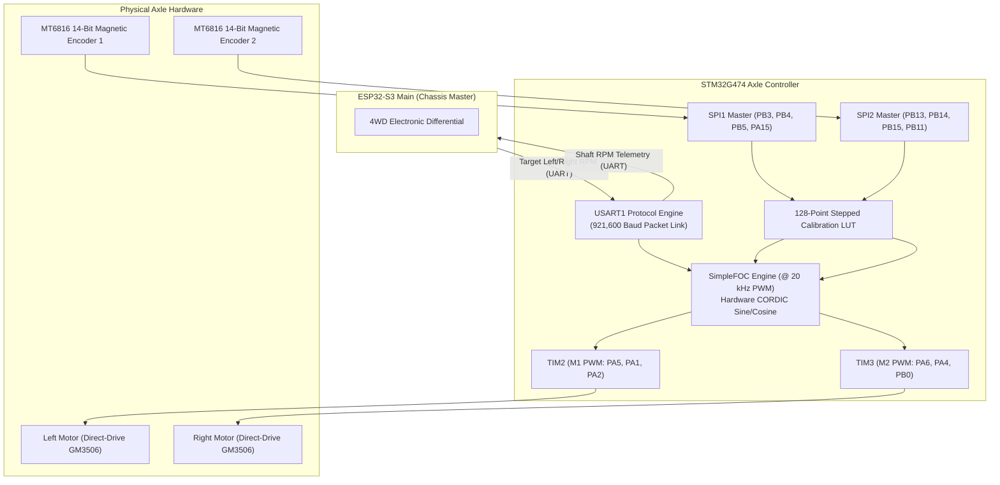

# STM32 Dual-Motor FOC Architecture

The Folkrace drivetrain is driven by **two independent STM32G474CBT6 microcontrollers**, each controlling a single axle with two direct-drive brushless motors running hardware-accelerated Field Oriented Control (FOC):

1. **Front Axle Controller**: Drives Front-Left (M1) and Front-Right (M2) direct-drive motors.
2. **Rear Axle Controller**: Drives Rear-Left (M3) and Rear-Right (M4) direct-drive motors.

Both microcontrollers run identical high-performance firmware, receiving individual velocity setpoints from the **ESP32 Main** chassis master over high-speed UART and executing closed-loop velocity FOC at 20 kHz.

---

## 1. System Specifications & Features

* **MCU**: STM32G474CBT6 (Arm Cortex-M4F @ 170 MHz with hardware CORDIC and trig accelerators).
* **Motors**: GM3506 Brushless Gimbal Motors (24N22P, 11 pole pairs, 12V supply, zero-backlash direct-drive).
* **Encoders**: 2x MT6816 14-bit magnetic angle encoders connected via **two independent hardware SPI peripherals** (SPI1 and SPI2) for deterministic, low-latency position acquisition.
* **Control Frequencies**:
  * **20.0 kHz Hard Real-Time Commutation**: Center-aligned PWM generation on TIM2 and TIM3.
  * **4.0 kHz Velocity PID Loop**: Downsampled velocity tracking with back-EMF feedforward (`Kv = 130 RPM/V`).
  * **25 Hz Telemetry Stream**: Reports actual shaft RPM and diagnostic metrics.
* **Calibration & Non-Linearity Compensation**:
  * 128-point Stepped Harmonic Linearization Look-Up Table (LUT) to eliminate magnet non-linearity and cogging torque.
  * Automatic electrical zero alignment and phase symmetry tuning.

---

## 2. Hardware Architecture & Interfaces



---

## 3. Pin Mapping & Hardware Peripherals (STM32G474 LQFP48)

| Pin | Function / Role | Peripheral | Description |
| :--- | :--- | :--- | :--- |
| **PA1** | M1 PWM Phase B | TIM2_CH2 | Center-aligned 25 kHz PWM |
| **PA2** | M1 PWM Phase C | TIM2_CH3 | Center-aligned 25 kHz PWM |
| **PA3** | M1 Driver Enable | GPIO Out | Active-High inverter gate enable |
| **PA4** | M2 PWM Phase B | TIM3_CH2 | Center-aligned 25 kHz PWM |
| **PA5** | M1 PWM Phase A | TIM2_CH1 | Center-aligned 25 kHz PWM |
| **PA6** | M2 PWM Phase A | TIM3_CH1 | Center-aligned 25 kHz PWM |
| **PA7** | M2 Driver Enable | GPIO Out | Active-High inverter gate enable |
| **PA9** | Telemetry TX | USART1_TX | Binary telemetry packet stream to ESP32 |
| **PA10** | Telemetry RX | USART1_RX | Binary command packet stream from ESP32 |
| **PA11** | Native USB D- | USB | STM32 System ROM DFU Bootloader / CDC |
| **PA12** | Native USB D+ | USB | STM32 System ROM DFU Bootloader / CDC |
| **PA13** | SWDIO | SWD SYS | Hardware debug data |
| **PA14** | SWCLK | SWD SYS | Hardware debug clock |
| **PA15** | Motor 1 Encoder CS | GPIO Out | Chip Select for MT6816 #1 (SPI1) |
| **PB0** | M2 PWM Phase C | TIM3_CH3 | Center-aligned 25 kHz PWM |
| **PB3** | Encoder 1 SCK | SPI1_SCK | MT6816 #1 SPI Clock |
| **PB4** | Encoder 1 MISO | SPI1_MISO | MT6816 #1 SPI Data In |
| **PB5** | Encoder 1 MOSI | SPI1_MOSI | MT6816 #1 SPI Data Out |
| **PB11** | Motor 2 Encoder CS | GPIO Out | Chip Select for MT6816 #2 (SPI2) |
| **PB13** | Encoder 2 SCK | SPI2_SCK | MT6816 #2 SPI Clock (AF5) |
| **PB14** | Encoder 2 MISO | SPI2_MISO | MT6816 #2 SPI Data In (AF5) |
| **PB15** | Encoder 2 MOSI | SPI2_MOSI | MT6816 #2 SPI Data Out (AF5) |
| **PC13** | User LED | GPIO Out | Active-Low onboard status indicator |

---

## 4. Communication Protocol with ESP32 Main

Communication occurs over USART1 at **921,600 baud, 8N1** with structured binary packets:

### Downlink (ESP32 Main -> STM32):
* **Format**: 17-byte packet containing 0xAA sync byte, target Left RPM (float32), target Right RPM (float32), reserve fields, and an XOR checksum.
* **Rate**: 400 Hz synchronous loop.

### Uplink (STM32 -> ESP32 Main):
* **Format**: 18-byte packet containing 0x55 sync byte, actual Left shaft RPM (float32), actual Right shaft RPM (float32), voltage/health flags, and an XOR checksum.
* **Rate**: 25 to 100 Hz.

---

## 5. Firmware Build & USB DFU Flashing

The firmware is built using PlatformIO and uploaded over native USB via DFU:

```bash
# Build firmware
pio run -e stm32_dual_foc

# Flash over USB DFU bootloader
pio run -e stm32_dual_foc -t upload
```

> [!TIP]
> If flashing over USB DFU, ensure the board is in bootloader mode (BOOT0 pulled High on reset, or using the hands-free DFU jump routine).

---

## 6. Calibration & Bench Testing

* **Closed-Loop Bench Calibration GUI**:
  ```bash
  python launchers/5_stm32_encoder_motor_gui.py
  ```
  Provides a real-time oscilloscope, target RPM sliders, 128-point LUT calibration routines, and harmonic distortion analysis.

* **Automatic Symmetry Tuner**:
  ```bash
  python STM32/auto_symmetry_tuner.py
  ```
  Tunes phase-to-phase PWM symmetry and verifies encoder linearity across full 360-degree mechanical rotations.
